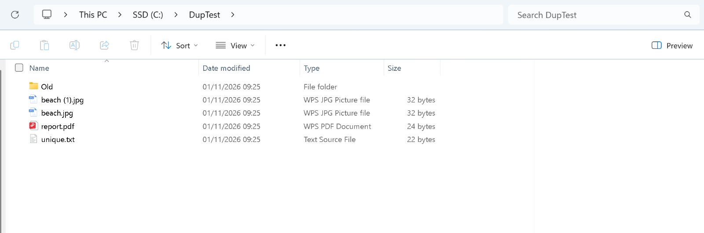
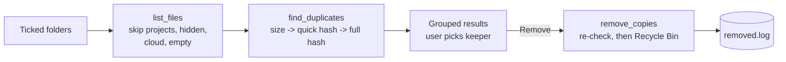

# Duplicate Finder

A Windows desktop app that finds files with identical content across your
folders (even when their names differ), shows them in groups, and sends the
extra copies to the Recycle Bin, **always keeping at least one copy**.

**Results**: duplicates grouped, with one copy marked Keep:



## Features

- **Pick folders**: Desktop, Downloads, Documents, Pictures, Videos and Music are detected automatically; add any other folder
- **Finds true duplicates** by content (SHA-256), not by name, across all subfolders
- **Grouped results** showing how much space each group wastes, biggest first
- **Choose which copy to keep**: double-click a copy; the simplest path is suggested by default (`photo.jpg` over `photo (1).jpg`)
- **Show in folder** opens File Explorer with the file selected, so you can check before removing
- **Removes to the Recycle Bin**, never a permanent delete, with a log of everything removed
- **Background scanning**: the window stays responsive on big folders
- **Single `.exe`**: no Python needed

## How it finds duplicates fast

Reading every byte of every file would be slow, so files are compared in three passes, each only on the files still matching:

| Pass | Compares | Why |
|---|---|---|
| 1. Size | File size (free, from the file system) | A file with a unique size can't have a copy, so it is never opened |
| 2. Quick hash | SHA-256 of the first 64 KB | Rules out most same-size files cheaply |
| 3. Full hash | SHA-256 of the whole file | Confirms true duplicates |

## Safety rules

| Rule | How it's enforced |
|---|---|
| Never remove the last copy | Right before each removal, both the copy and the kept file are re-checked: they must exist, be the same size and have the same full hash. If anything changed since the scan, the copy is skipped |
| Never permanently delete | Removal uses the Recycle Bin (`send2trash`); every removal is logged |
| A file is never its own copy | Overlapping folders (e.g. Documents and Documents\Work) are scanned once |
| Don't break code projects | Folders containing `.git`, `package.json`, `requirements.txt`, `.venv` etc. are skipped |
| Don't touch system or app folders | Drive roots, your whole user folder, `Windows`, `Program Files`, `ProgramData` and `AppData` are refused |
| Don't download cloud files | OneDrive "online-only" placeholders and links are skipped, so scanning never triggers downloads |
| Skip what shouldn't be touched | Hidden and system files, `desktop.ini`, and empty files are ignored |
| Partial failures are safe | A file open in another app is skipped and reported; the rest continue |

## Tech stack

- Python 3.11+
- Tkinter (built into Python) for the window
- `hashlib` (SHA-256) for content comparison
- `send2trash` for Recycle Bin support
- pytest for tests
- PyInstaller to build the `.exe`

## Project structure

```
duplicate-finder/
  app.py            # the window; scanning runs on a background thread (no logic)
  finder.py         # all the logic: scan, group, plan and remove
  tests/            # 29 tests, all run on temporary folders
  docs/screenshots/
  requirements.txt
  LICENSE
```

## How it works



1. **Scan** (background thread): `list_files()` collects files from the ticked folders, then `find_duplicates()` groups identical files using the three passes above. The window checks every 200 ms whether the scan has finished.
2. **Review**: groups are shown with one copy marked Keep. `set_keeper()` changes it.
3. **Remove**: `plan_removals()` lists every copy except the keeper; `remove_copies()` re-checks each one, sends it to the Recycle Bin and logs it to `%LOCALAPPDATA%\DuplicateFinder\removed.log`.

`finder.py` has no UI code, so all of this is tested without a window.

## Setup

### Just use it
Download `DuplicateFinder.exe` from the [Releases](../../releases) page and double-click it.

> Windows SmartScreen may warn that the app is unrecognised, because it isn't code-signed. Click **More info**, then **Run anyway**.

### Run from source (PowerShell)
```powershell
git clone https://github.com/nexusknox/duplicate-finder.git
cd duplicate-finder
python -m venv .venv
.\.venv\Scripts\Activate.ps1
pip install -r requirements.txt
python app.py
```

Run the tests:
```powershell
pytest
```

Build the `.exe`:
```powershell
pip install pyinstaller
pyinstaller --onefile --windowed --name DuplicateFinder app.py
```

No API keys or environment variables are needed.

### Try it safely first
```powershell
mkdir C:\DupTest\Old; cd C:\DupTest
"holiday photo" > beach.jpg; "holiday photo" > "beach (1).jpg"; "holiday photo" > Old\IMG_0042.jpg
"my report" > report.pdf; "my report" > Old\report.pdf
```
Then use **Add another folder…** to pick `C:\DupTest`.

## Limitations

- **No in-app undo**: removed copies are restored from the Windows Recycle Bin (the log shows what was removed and where)
- **Windows only** for real use (logic and tests run anywhere)
- **Exact duplicates only**: a resized or re-saved photo is a different file and won't be matched
- **Very large folders** (hundreds of thousands of files) can take several minutes; there is no progress bar or cancel button yet
- Empty files are ignored
- Online-only OneDrive files are skipped, so duplicates stored only in the cloud aren't found
- Tested manually on Windows 11; the `.exe` isn't code-signed

## Future improvements

- Progress bar and a Cancel button for long scans
- Rules for choosing keepers in bulk (e.g. "always keep the copy in Pictures")
- Similar-image detection (resized or re-saved photos)
- Export results to CSV
- Minimum file size filter to focus on big wins

## License

MIT, see [LICENSE](LICENSE).